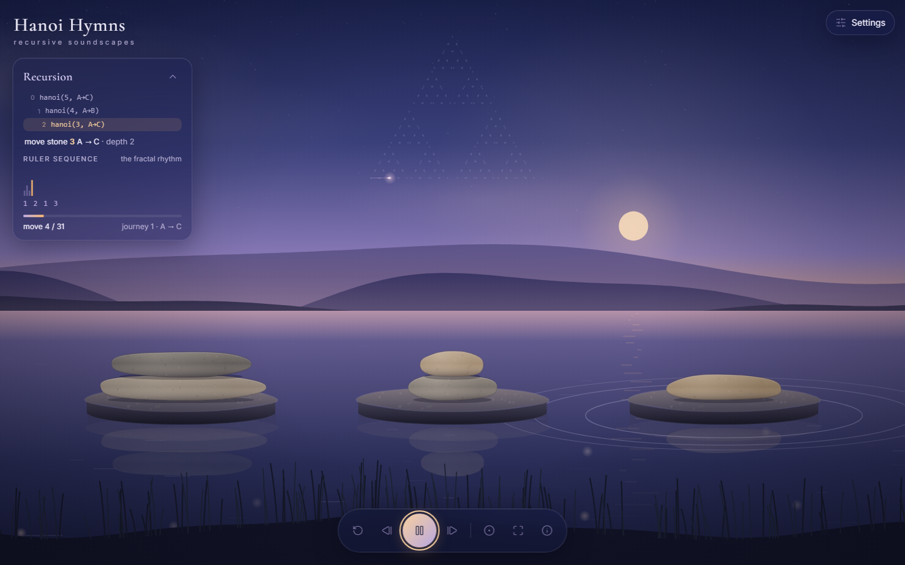

# 🪨 Hanoi Hymns — Recursive Soundscapes

> *Every call asks a musical question. Every return answers it.*

A calm riverside at dusk. River stones rest on three flat rocks in the water. A **truly recursive
Tower of Hanoi** carries them across, one by one — and every move rings a singing bowl, a kalimba
or a warm pad. The recursion doesn't just *drive* the music: it **is** the music.

**Live demo:** _coming soon — `https://<your-user>.github.io/<repo>/`_



| Deep Sleep (8 stones, move 102 / 255 on the Sierpinski path) | Mobile |
|---|---|
|  |  |

<!-- Placeholder: add a short demo GIF / video link here -->
**Demo video:** _coming soon_

---

## The key insight: recursion composes a fractal rhythm

Write down which stone moves at each step of the Hanoi solution:

```
1 2 1 3 1 2 1 4 1 2 1 3 1 2 1 5 …
```

This is the **ruler sequence** — it looks like the tick marks on a ruler. Every block is two copies
of the previous block joined by a new, larger number: a **fractal**, self-similar at every scale.

In Hanoi Hymns that sequence becomes the melody (each stone has its own pitch) *and* the rhythm
(after a bigger stone moves, the river takes a longer breath). Small, high stones chime often;
big, low stones speak rarely and deeply — and the very largest stone, which moves only once,
in the exact middle of the piece, is marked by a deep gong. You can watch the ruler sequence build up
live as a bar chart in the recursion panel.

## How the recursion maps to music

| Recursion property | Musical / visual result |
|---|---|
| **Stone size** (1 … n) | Pitch on the chosen scale — largest stone = lowest note, smallest = highest |
| **Destination peg** A / B / C | Instrument (e.g. A = singing bowl, B = kalimba, C = warm pad) **and** stereo position (left / centre / right) |
| **Recursion depth** of the call that moves the stone | Reverb send + delay send — deeper calls echo further away, so you can *hear* the recursion |
| **Ruler sequence** of moved stones | Melody contour and rhythm — gap after a move grows with the stone's size (fractal breathing) |
| **Largest stone's single move** | Deep gong-like bowl one octave lower — the centre of the recursion |
| **Total moves 2ⁿ − 1** | Length of the piece (7 moves for 3 stones … 255 for 8) |
| **Seed** | Tiny humanization (velocity, micro-timing, detune). Same seed + settings ⇒ same composition |

Underneath everything: a quiet drone on the root (a tanpura-like shimmer for the raga mood) and a
synthesized ambience of rain, river and wind.

## Recursion → Musical Form

> *The recursion doesn't just play notes — it composes. Every call asks a musical question;
> every return answers it.*

The recursive generator yields the **structure** of the computation, not just its moves:
`enter` (a call begins), `move` (the stone moved inside that call) and `return` (the call ends),
each with its depth. The composer turns that structure into musical form:

| Recursion event | Musical meaning |
|---|---|
| `enter` a call of size ≥ 2 | **A question**: the harmony steps *away* from its parent chord (vi, sus, quartal, IV … chosen by depth and target rock) |
| `move` | **The melody**: stone size → pitch; on strong beats the note settles on a tone of the current chord |
| `return` | **The answer**: the harmony falls back to the parent's chord, a small cadence; the dynamics soften |
| base case (one stone) | A simple step: it keeps its parent's harmony, no extra motion |
| top-level call | Opens on the tonic with a soft bowl strike and closes on the tonic with a final bowl and a long tail |

Because the harmony is kept on a stack that mirrors the call stack, **phrases nest exactly like
calls**: a call of size *k* lasts 2ᵏ − 1 moves, so phrases are 1, 3, 7, 15 … moves long, each one a
smaller copy of the whole. The middle move of every phrase is its largest stone, so dynamics swell
gently toward each phrase's middle and relax at its cadence. The ruler sequence doubles as a metric
hierarchy: moves of stone ≥ 2 are strong beats.

Enter/return events never add notes and never take time. They only move the harmony pad (four
softly detuned voices that glide to the nearest note of the next chord, never forming a second)
and the dynamics, so the calm pulse stays untouched. Each mood has its own consonant chord set:
open fifths, sus2/sus4 and stacked fourths for Pentatonic, Hirajoshi and Bhupali; i7 · IV · bVII ·
bIII · ii for Dorian. Across every mood, root and stone count, the voice-leading test found no
clashing voices in 14,064 chord changes.

## Hanoi → Sierpinski

With *n* stones there are **3ⁿ** arrangements, because every stone can sit on any of the three rocks.
Connect the arrangements that are one move apart and the graph you get is a **Sierpinski
triangle**:

- the rock holding the **largest** stone picks one of the three corner sub-triangles,
- the next stone picks a sub-sub-triangle inside it, and so on down to the smallest stone,
- inside each sub-triangle the other two corners are swapped, which is exactly what turns a move
  of the largest stone into the short bridge between two neighbouring sub-triangles.

`src/visual/sierpinski.js` computes every state's position with that recursion, and the scene
draws all 3ⁿ states (6,561 for eight stones, pre-rendered once) as a faint constellation in the
evening sky. On each move the current state lights up amber and a thin glowing line follows the
flying stone from the previous state. The optimal solution walks **straight along one side of
the fractal**, from one corner to another. When the solve ends, the whole path glows across the
triangle and then slowly fades. It can be toggled in the panel.

## Features

- **Configurable recursive algorithm** — a real recursive generator (`src/recursion/hanoi.js`),
  3–8 stones, any start and target rock. Each move carries its depth and a snapshot of the call stack.
- **2.5D riverside scene** — dusk sky with slowly appearing stars, moon glow, drifting clouds, three
  parallax hill ranges, mist, a flowing river with reflections, fireflies and swaying grass.
  Stones are soft-shaded river-stone shapes in earthy tones that travel in slow eased arcs;
  landings send out water ripples and a glow pulse in sync with the sound.
- **Live recursion panel** — the call stack (`hanoi(4, A→C)` …) with the active depth highlighted,
  the current move, the ruler sequence as a growing bar chart, and progress *move X / 2ⁿ − 1*.
- **Procedural music (Tone.js, 100 % synthesized)** — singing bowl (inharmonic partials with gentle
  beating), kalimba (soft pluck with tine overtone), warm pad (detuned triangles, slow filter swell);
  4 moods: *Pentatonic Major (Calm)*, *Hirajoshi (Zen)*, *Raga Bhupali (Bangla Dusk)*, *Dorian (Dreamy)*,
  any root note; drone; rain (filtered noise + random droplets), river, wind.
- **Mixing rules** — soft attacks; low-cut at 80 Hz on everything but the drone; gentle high-shelf
  cut above 7 kHz on bells; one shared 7 s reverb (40 ms pre-delay); ping-pong echo; soft
  compressor and limiter; master level ≈ −10 dB; every change ramped (no clicks); at most 7 ringing
  voices so tails never turn to mud. Audio starts only after *Begin*.
- **Controls** — collapsible glass panel with Lucide line icons: stones, mood, root, breath pace
  (slow / medium / flow), instrument presets per rock, echo depth, seed with a dice button, endless
  journey, ambience mixer, Sierpinski constellation, sky (dusk to night), master volume.
  Play / pause / restart / step back / step forward. Sound settings apply instantly; changing pace
  or seed keeps your place in the piece.
- **Presets** — Morning Mist · Monsoon Evening · Temple Night · Deep Sleep, each with a small
  hand-drawn mood thumbnail.
- **Share link** — all settings + seed live in the URL hash; anyone opening it hears the same piece.
- **Download my soundscape** — renders one full solve offline with the *same* audio graph, fades in
  over 2 s and out naturally, normalises to about −16 LUFS with peaks below −1 dBFS, and saves a
  16-bit stereo 44.1 kHz WAV. A calm progress card shows meanwhile. The filename includes preset,
  stones, scale and seed. (Measured: 60 s of Morning Mist → −16.0 LUFS, peak −2.96 dBFS,
  RMS −18.4 dBFS, no clipping.)
- **Calm tools** — breathing guide (inhale 4 · hold 4 · exhale 6, following the pace), sleep timer
  (10 / 20 / 30 min with a one-minute fade-out), focus mode (hide all UI), *About the math* modal.
- **Accessible** — full keyboard control, visible focus rings, ARIA labels, good contrast,
  `prefers-reduced-motion` support (no parallax / sway / rain streaks, lower arcs), responsive
  layout for laptop and mobile.

## Keyboard shortcuts

| Key | Action |
|---|---|
| `Space` | Play / pause |
| `→` / `←` | Step forward / step back one move |
| `R` | Restart |
| `F` | Focus mode (hide UI) · `Esc` to leave |
| `B` | Breathing guide |
| `S` | Settings panel |
| `?` | About the math |

## Run it

```bash
npm install
npm run dev      # → http://localhost:5173
npm run build    # production build in dist/
npm run preview  # serve the build locally
```

Deploying to GitHub Pages: `vite.config.js` uses `base: './'`, so the contents of `dist/` work from
any sub-path. Push `dist/` to a `gh-pages` branch (or use a Pages workflow).

## Tech stack

- **Vite 6** + **vanilla JavaScript** (ES modules) — no framework
- **Tone.js 15** — audio context, filters, compressor, limiter, ping-pong delay, convolver, offline rendering
- **Web Audio** raw nodes for per-note voices, LFOs and seeded noise (cheap enough for long offline renders)
- **Canvas 2D** — the whole scene, with pre-rendered stone and rock sprites for smooth 60 fps

```
src/
  recursion/hanoi.js     recursive generator of enter / move / return events with depth + call stack
  recursion/composer.js  call structure → timed score: harmony stack, phrases, swell, cadences
  audio/harmony.js       consonant chord sets per mood, voice leading, chord-tone snapping
  audio/engine.js        graph, instruments, harmony pad, drone, ambience, performer (polyphony cap)
  audio/export.js        offline render, BS.1770 loudness normalisation, 16-bit WAV encoder
  conductor.js           one clock for sound & sight; look-ahead scheduler; pause/step/endless
  visual/scene.js        riverside canvas scene, stones, ripples, glows, constellation
  visual/sierpinski.js   recursive Sierpinski layout of all 3^n Hanoi states
  visual/stack.js        live call stack + ruler sequence + progress
  ui/controls.js         settings panel, presets
  settings.js            scales, presets, share-link encoding, pitch mapping
  main.js                wiring, landing, calm tools, keyboard
```

## How AI was used

This project was built with **Claude Code** (Anthropic's agentic coding CLI) during the hackathon.
The complete prompt chain — every prompt and every full AI response — is in [`ai-logs/`](ai-logs/):

- [`ai-logs/session-01.md`](ai-logs/session-01.md) — full export of the first build session
- [`ai-logs/claude-code-log.md`](ai-logs/claude-code-log.md) — automatic hook-based log of all later sessions
- [`ai-logs/README.md`](ai-logs/README.md) — how the logging works

The human author directed the concept, requirements and judging priorities; Claude Code wrote the
code, tuned the sound design (measured levels with offline renders) and the visuals, and documented
its decisions.

## License

MIT — all sounds are synthesized in the browser; no third-party audio assets.
